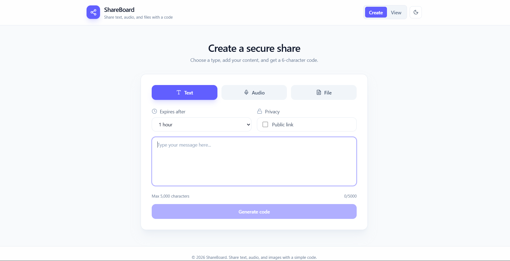
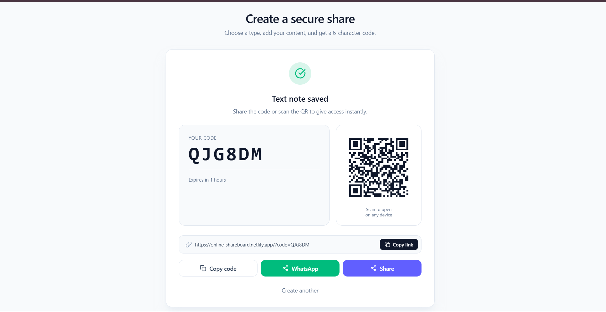
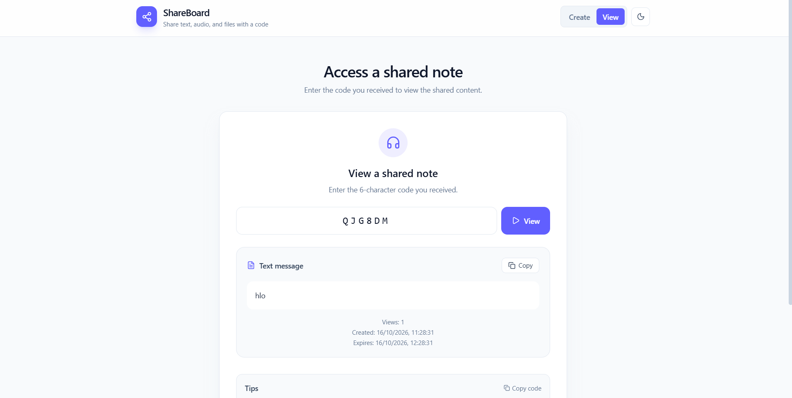

# 🎙️ ShareBoard

> Share text, audio, and any file (PDF, PPT, DOC, ZIP, images) with a simple 6-character code or QR.

[](https://online-shareboard.netlify.app)
[](https://shareboard-backend-qd91.onrender.com/health)
[](LICENSE)

---

## 📖 Overview

**ShareBoard** is a full-stack web app for sharing content instantly — no login, no signup, no friction. Just create a note, get a short code (with a QR code and share link), and send it to anyone. Files auto-expire after a chosen duration.

Built with a focus on **clean UX**, **password-protected shares**, and **support for any file type**.

---

## ✨ Features

### Core
- 📝 **Text notes** — up to 5,000 characters, one-click copy
- 🎤 **Voice notes** — record directly in the browser
- 📎 **Any file type** — PDF, PPT/PPTX, DOC/DOCX, XLS/XLSX, TXT, CSV, ZIP, RAR, 7Z, JPG, PNG, GIF, WEBP, SVG
- 🔑 **6-character codes** — uppercase alphanumeric, easy to share verbally
- 📱 **QR code** — scan to open the note instantly on any device
- 🔗 **Share link** — direct URL with the code pre-filled (`?code=ABC123`)
- 📲 **One-tap sharing** — WhatsApp and native share sheet

### Security & Privacy
- 🔒 **Password protection** — bcrypt-hashed, optional per note
- ⏰ **Auto-expiry** — 1 hour to 7 days (MongoDB TTL index)
- 👁️ **Anonymous** — no accounts, no tracking

### UX
- 🌗 **Light / dark theme** — persists across sessions
- 🎨 **Smooth animations** — Framer Motion throughout
- 📱 **Fully responsive** — mobile-first design
- ⚡ **Warm backend** — never hits a cold start

---

## 🖼️ Screenshots

| Create | Share | View |
|---|---|---|
|  |  |  |

> Add your own screenshots to `docs/screenshots/` — 3 images are enough.

---

## 🛠️ Tech Stack

### Frontend
| Tech | Purpose |
|---|---|
| **React 19** | UI library |
| **Vite** | Build tool & dev server |
| **Tailwind CSS v4** | Utility-first styling |
| **Framer Motion** | Animations |
| **Axios** | HTTP client |
| **qrcode.react** | QR code generation |
| **Lucide React** | Icons |

### Backend
| Tech | Purpose |
|---|---|
| **Node.js + Express 5** | REST API |
| **MongoDB Atlas** | Database (with TTL auto-expiry) |
| **Mongoose** | ODM |
| **Multer** | File upload (in-memory → Base64) |
| **bcryptjs** | Password hashing |

### Deployment
- **Frontend** → Netlify
- **Backend** → Render
- **Database** → MongoDB Atlas (free tier)
- **Uptime** → UptimeRobot (5-min ping)

---

## 🏗️ Architecture

```
┌─────────────────┐         ┌──────────────────┐         ┌────────────────┐
│                 │  HTTPS  │                  │  Mongo  │                │
│  React (Vite)   │────────▶│  Express API     │────────▶│  MongoDB Atlas │
│  Netlify        │         │  Render          │         │  (TTL index)   │
│                 │         │                  │         │                │
└─────────────────┘         └──────────────────┘         └────────────────┘
       │                            ▲
       │                            │
       └──── QR scan / ?code= ──────┘
```

**Note flow:**
1. User submits text / audio / file
2. Backend generates a unique 6-char code, stores content as Base64
3. Frontend shows code + QR + share link
4. Receiver opens link or enters code → content fetched
5. After expiry, MongoDB TTL automatically deletes the note

---

## 🚀 Getting Started

### Prerequisites
- Node.js **v20.19+** (required by Mongoose 9 & Vite 8)
- MongoDB Atlas account (or local MongoDB)
- Git

### 1. Clone the repo
```bash
git clone https://github.com/YOUR_USERNAME/shareboard.git
cd shareboard
```

### 2. Backend setup

```bash
cd backend
npm install
```

Create `backend/.env`:
```env
MONGO_URI=mongodb+srv://<user>:<password>@<cluster>/shareboard?retryWrites=true&w=majority
PORT=5000
FRONTEND_URL=http://localhost:5173
```

Run:
```bash
npm run dev
```
Backend runs on `http://localhost:5000`.

### 3. Frontend setup

```bash
cd ../frontend
npm install
```

Create `frontend/.env.development`:
```env
VITE_API_URL=http://localhost:5000/api
```

Run:
```bash
npm run dev
```
Frontend runs on `http://localhost:5173`.

---

## 📡 API Reference

Base URL: `https://shareboard-backend-qd91.onrender.com/api`

| Method | Endpoint | Description |
|---|---|---|
| `GET` | `/health` | Health check |
| `POST` | `/audio/text` | Create text note |
| `POST` | `/audio/upload` | Upload audio (multipart) |
| `POST` | `/audio/upload-file` | Upload any file (multipart) |
| `GET` | `/audio/info/:code` | Get note metadata |
| `GET` | `/audio/:code` | Fetch note content (optional `?password=`) |

### Example — Create text note

**Request**
```http
POST /api/audio/text
Content-Type: application/json

{
  "text": "Hello world",
  "password": "optional",
  "expiryHours": 24
}
```

**Response**
```json
{
  "success": true,
  "code": "AB12CD",
  "type": "text",
  "isProtected": true,
  "expiresIn": "24 hours"
}
```

### Example — Fetch note

**Request**
```http
GET /api/audio/AB12CD?password=optional
```

**Response**
```json
{
  "type": "text",
  "content": "Hello world",
  "views": 3,
  "createdAt": "2026-01-15T10:30:00.000Z",
  "expiresAt": "2026-01-16T10:30:00.000Z"
}
```

---

## 📁 Project Structure

```
Online_AudioBoard/
├── backend/
│   ├── controllers/
│   │   └── noteController.js       # Business logic
│   ├── middleware/
│   │   └── upload.js                # Multer config
│   ├── models/
│   │   └── Note.js                  # Mongoose schema (with TTL)
│   ├── routes/
│   │   └── audio.js                 # API routes
│   ├── server.js
│   └── package.json
│
└── frontend/
    ├── public/
    │   ├── _redirects               # Netlify SPA fallback
    │   └── favicon.svg
    ├── src/
    │   ├── components/
    │   │   ├── CreateNote.jsx
    │   │   ├── ViewNote.jsx
    │   │   └── Footer.jsx
    │   ├── hooks/
    │   │   └── useTheme.js
    │   ├── config.js                # API URL resolution
    │   ├── App.jsx
    │   ├── main.jsx
    │   └── index.css
    ├── index.html
    ├── vite.config.js
    └── package.json
```

---

## 🔐 Environment Variables

### Backend (`backend/.env`)
| Variable | Description |
|---|---|
| `MONGO_URI` | MongoDB Atlas connection string |
| `PORT` | Server port (default: 5000) |
| `FRONTEND_URL` | Allowed CORS origin |

### Frontend (`frontend/.env`)
| Variable | Description |
|---|---|
| `VITE_API_URL` | Backend API base URL |

> ⚠️ **Never commit `.env` files.** They are already in `.gitignore`.

---

## 🚢 Deployment

### Backend → Render
1. Push to GitHub
2. Render → **New Web Service** → connect repo
3. **Root directory:** `backend`
4. **Build command:** `npm install`
5. **Start command:** `npm start`
6. Add env vars: `MONGO_URI`, `PORT`, `FRONTEND_URL`
7. Deploy

### Frontend → Netlify
1. Netlify → **Add new site** → import from GitHub
2. **Base directory:** `frontend`
3. **Build command:** `npm run build`
4. **Publish directory:** `frontend/dist`
5. Add env var: `VITE_API_URL=https://your-backend.onrender.com/api`
6. Deploy

### Keeping backend warm (free tier tip)
Render free tier sleeps after 15 min of inactivity. Use [UptimeRobot](https://uptimerobot.com):
- Monitor type: **HTTP(s)**
- URL: `https://your-backend.onrender.com/health`
- Interval: **5 minutes**

---

## 🧪 Roadmap

- [ ] User accounts & dashboard (view your past notes)
- [ ] Analytics — total notes created, total views
- [ ] Live expiry countdown on view page
- [ ] Rate limiting on uploads
- [ ] End-to-end encryption (client-side)
- [ ] Custom QR download button

---

## 🤝 Contributing

Contributions welcome! Fork, create a feature branch, and open a PR.

```bash
git checkout -b feature/amazing-feature
git commit -m "Add amazing feature"
git push origin feature/amazing-feature
```

---

## 📄 License

MIT © Jatin

---

## 🙏 Acknowledgements

- [Vite](https://vitejs.dev)
- [Tailwind CSS](https://tailwindcss.com)
- [Framer Motion](https://www.framer.com/motion/)
- [MongoDB Atlas](https://www.mongodb.com/atlas)
- [Render](https://render.com)
- [Netlify](https://netlify.com)

---

<p align="center">
  <strong>⭐ If you found this useful, give it a star!</strong>
</p>